# Global Electronics Retailer – Sales Performance Dashboard (Power BI)

An end-to-end analytics project on five years of sales data from a fictional global electronics retailer: data profiling in **Excel**, cleaning in **Power Query**, a **star-schema data model**, **30+ DAX measures**, and a 4-page interactive **Power BI** dashboard that answers five business questions.

**Tools:** Excel · Power Query (M) · Power BI Desktop · DAX
**Dataset:** [Maven Analytics – Global Electronics Retailer](https://mavenanalytics.io/data-playground) (free, fictional data)

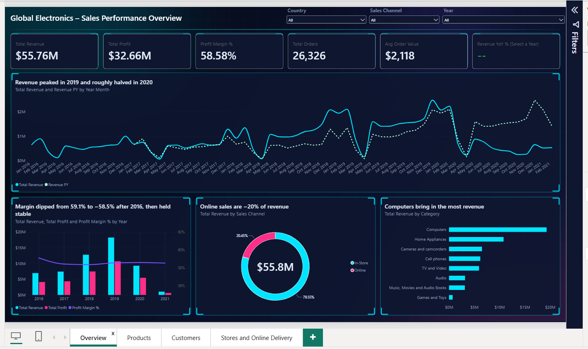

---

## Table of contents
1. [Business questions](#1-business-questions)
2. [Key results at a glance](#2-key-results-at-a-glance)
3. [The dataset](#3-the-dataset)
4. [Process overview](#4-process-overview)
5. [Step 1 – Data profiling in Excel](#5-step-1--data-profiling-in-excel)
6. [Step 2 – Cleaning and transforming in Power Query](#6-step-2--cleaning-and-transforming-in-power-query)
7. [Step 3 – Data model (star schema)](#7-step-3--data-model-star-schema)
8. [Step 4 – Calculated columns (DAX)](#8-step-4--calculated-columns-dax)
9. [Step 5 – Measures (DAX)](#9-step-5--measures-dax)
10. [Step 6 – Dashboard design](#10-step-6--dashboard-design)
11. [Answers to the business questions](#11-answers-to-the-business-questions)
12. [Recommendations](#12-recommendations)
13. [Assumptions and limitations](#13-assumptions-and-limitations)
14. [Repository structure](#14-repository-structure)

---

## 1. Business questions

Before touching the data, I defined the questions the dashboard had to answer:

1. **How have revenue and profit changed over time, and is the business growing?**
2. **Which products, brands and categories make the most profit, not just the most sales?**
3. **Which countries and stores perform best, and how do online sales compare with in-store?**
4. **Who are our customers (age, gender, location), and who buys the most?**
5. **How long do online deliveries take, and is that improving?**

---

## 2. Key results at a glance

| Metric | Value |
|---|---|
| Total revenue | **$55.76M** |
| Total profit | **$32.66M** |
| Profit margin | **58.6%** |
| Orders | **26,326** |
| Average order value | **$2,118** |
| Customers who purchased | **11,887** |
| Repeat customers | **61.2%** |
| Online share of revenue | **20.5%** |
| Physical stores | **57** (+ 1 online store) |

- Revenue grew **2.6×** from 2016 to its 2019 peak ($18.26M), then fell **49%** in 2020.
- The 2020 fall came from **fewer orders**, not lower prices or margins. Margin held at 58–59% every year.
- **Online** grew its share of revenue every year (16.8% → 22.3%), while average **delivery time halved** (~8 → ~4 days).
- **US customers** spend the most and return the most (69% repeat rate). Australia and France return the least (~38–40%).

---

## 3. The dataset

Five CSV tables plus a data dictionary, covering orders from **January 2016 to February 2021**.

| Table | Rows | Key | Description |
|---|---|---|---|
| **Sales** | 62,884 | Order Number + Line Item | One row per product in an order: dates, customer, store, product, quantity, currency |
| **Customers** | 15,266 | CustomerKey (unique) | Gender, name, city, state, country, continent, birthday |
| **Products** | 2,517 | ProductKey (unique) | Name, brand, colour, unit cost, unit price, subcategory, category |
| **Stores** | 67 | StoreKey (unique) | Country, state, square metres, open date. **StoreKey 0 = Online store** |
| **Exchange_Rates** | 11,215 | Date + Currency | Daily exchange rates (not needed; all prices are in USD) |

---

## 4. Process overview

```
Raw CSVs (never edited)
   │
   ▼
Excel ── profile each table, log every issue in a Data Profile sheet
   │
   ▼
Power Query ── fix types, locales, text prices, zip codes; add helper columns; quality checks
   │
   ▼
Data model ── star schema + custom Date table + active/inactive date relationships
   │
   ▼
DAX ── calculated columns (age, groups, frequency) + 30+ measures (KPIs, time intelligence)
   │
   ▼
Power BI report ── 4 pages, one per business question area, with insight-driven titles
```

**Principle:** the raw CSV files in `data/raw/` were never edited. Every cleaning step lives in Power Query, so it is **repeatable** (Refresh reapplies it), **transparent** (each step is named in Applied Steps) and **reversible** (any step can be deleted).

---

## 5. Step 1 – Data profiling in Excel

I opened each CSV in Excel (saving a separate `.xlsx` copy) to understand the structure and record problems before cleaning anything. I checked row counts, key uniqueness (`COUNTA` vs `ROWS(UNIQUE())`), blanks (`COUNTBLANK`) and data types (text vs number alignment).

| Table | Column | Issue found | Rows affected | Fix (applied in Power Query) |
|---|---|---|---|---|
| Customers | CustomerKey | None: 15,266 rows, 15,266 unique, no blanks | – | – |
| Customers | Birthday | US date format (M/D/YYYY), which a Nigerian/UK locale misreads | All | Change type **using locale English (US)** |
| Customers | Zip Code | Leading zeros lost (e.g. `0852` read as `852`) | Some | Pad back by country, store as text |
| Customers | Name | Accented characters at risk of breaking | Some | Import as **UTF-8 (65001)** |
| Products | ProductKey | None: 2,517 rows, 2,517 unique | – | – |
| Products | Unit Cost USD, Unit Price USD | Stored as **text with "$" and ","**, so they can't be summed | All | Remove "$" and ",", trim, convert to decimal |
| Sales | – | 62,884 rows; no single unique key (Order Number + Line Item) | – | Kept as fact table |
| Sales | Delivery Date | **Blank** for most rows | In-store orders | Expected: only online orders are delivered. Kept blank |
| Sales | Order Date, Delivery Date | US date format | All | Change type using locale English (US) |
| Stores | StoreKey | 67 rows, 67 unique | – | – |
| Stores | Square Meters | **Blank for StoreKey 0** | 1 | Expected: the online store has no floor space. Kept blank (not 0) and excluded from per-m² metrics |
| Exchange_Rates | – | No blanks, 11,215 rows | – | Not used: all prices already in USD |

---

## 6. Step 2 – Cleaning and transforming in Power Query

All five tables were loaded with **Get Data → Text/CSV**. Power Query automatically adds a "Changed Type" step that guesses column types. Its guesses were wrong for the US dates and zip codes, so I **deleted the automatic step on every table and set each type deliberately**.

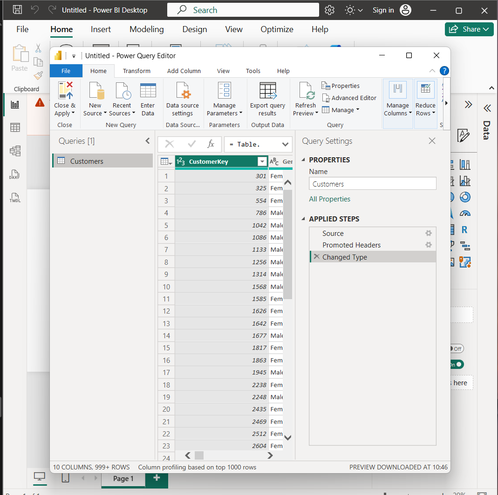
*Initial import of the Customers table, showing the automatic "Changed Type" step that was later replaced.*

### 6.1 Reading US dates correctly (all tables)

The CSV dates are in US format (month/day/year). A plain type change on a non-US machine can read 3/7/2019 as 3 July instead of 7 March, or fail entirely. Every date column was converted with **Change Type → Using Locale → Date → English (United States)**:

```m
= Table.TransformColumnTypes(#"Renamed Columns", {{"Birthday", type date}}, "en-US")
```

The same pattern was applied to `Order Date` and `Delivery Date` (Sales) and `Open Date` (Stores). I verified the result with **View → Column quality** set to profile the **entire dataset** (not just the first 1,000 rows): **0% errors** on every date column.

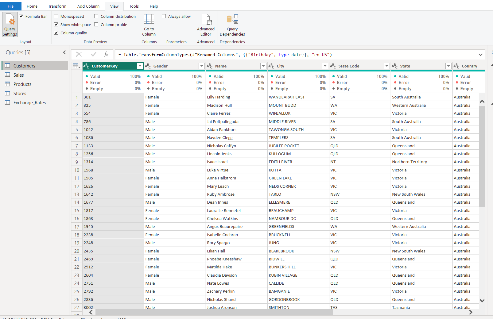
*Birthday converted with the en-US locale; Column quality shows 100% valid, 0% error, 0% empty.*

### 6.2 Customers – restoring zip code leading zeros

When the CSV was read as numbers, zip codes like `0852` (Darwin, Australia) lost their leading zero. Only countries with fixed-length numeric postcodes were padded; UK and Canadian postcodes contain letters and were left as they were.

```m
= if List.Contains({"United States","Germany","France","Italy"}, [Country])
      then Text.PadStart(Text.From([Zip Code]), 5, "0")
  else if [Country] = "Australia"
      then Text.PadStart(Text.From([Zip Code]), 4, "0")
  else Text.From([Zip Code])
```

The original column was then removed and the new one renamed to `Zip Code` (stored as text).

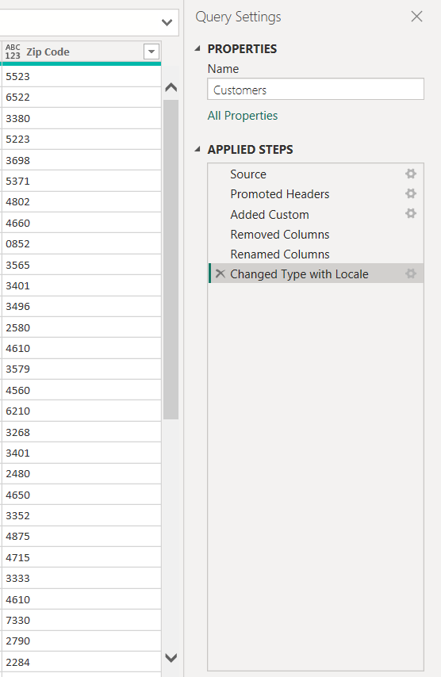
*Zip codes after the fix (e.g. 0852 keeps its zero), with the Added Custom → Removed Columns → Renamed Columns steps.*

### 6.3 Products – cleaning text prices

`Unit Cost USD` and `Unit Price USD` arrived as text such as `"$1,089.00"`. Steps:

1. **Replace Values** `$` → nothing
2. **Replace Values** `,` → nothing (prices over $1,000)
3. **Format → Trim** (removes stray spaces that cause conversion errors)
4. **Change Type → Decimal Number**

```m
= Table.ReplaceValue(Source, "$", "", Replacer.ReplaceText, {"Unit Cost USD", "Unit Price USD"})
= Table.ReplaceValue(#"Replaced Value", ",", "", Replacer.ReplaceText, {"Unit Cost USD", "Unit Price USD"})
= Table.TransformColumns(#"Replaced Value1", {{"Unit Cost USD", Text.Trim, type text}, {"Unit Price USD", Text.Trim, type text}})
= Table.TransformColumnTypes(#"Trimmed Text", {{"Unit Cost USD", type number}, {"Unit Price USD", type number}})
```

#### Quality check: is any product sold below cost?

To validate the cleaned prices, I added a temporary QC flag that marks any product whose cost is higher than its price:

```m
= Table.AddColumn(#"Changed Type1", "Price QC", each if [Unit Cost USD] > [Unit Price USD] then "1" else "0")
```

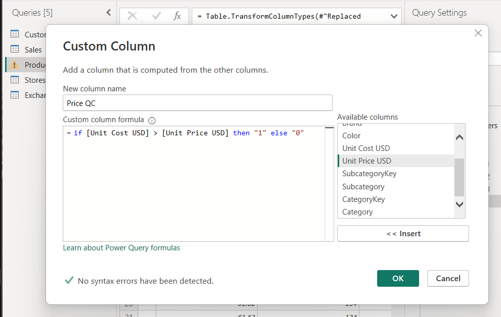
*The Price QC custom column.*

The filter on the new column returned **only "0"**. **No product is priced below its cost**, which confirms that the price cleaning worked and that every product carries a positive margin.

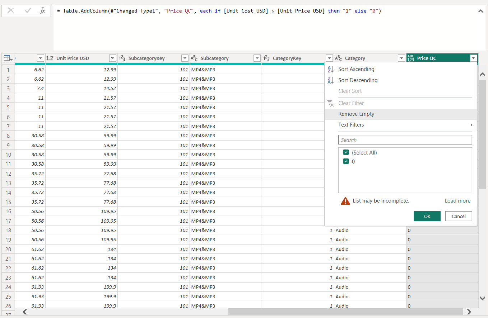
*Filter values for Price QC: only 0 (no loss-making prices).*

### 6.4 Sales – Delivery Days and Sales Channel

**Delivery Days:** the number of days between order and delivery (online orders only).

```m
= Duration.Days([Delivery Date] - [Order Date])
```

In-store orders have no delivery date, so they return `null`, which is correct. The column was then set explicitly to **Whole Number**. A custom column defaults to type *Any*, which loads into Power BI as text and breaks `AVERAGE`.

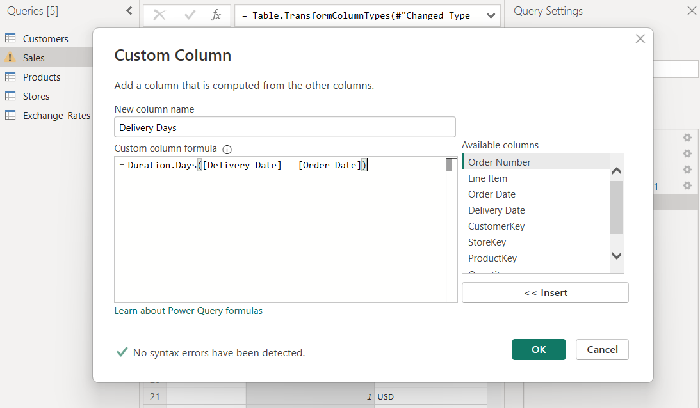

**Sales Channel:** labels each order Online or In-Store using the StoreKey 0 rule from the data dictionary.

```m
= if [StoreKey] = 0 then "Online" else "In-Store"
```

> **Lesson learned:** the first version labelled every row "In-Store", because the step ran while StoreKey was still **text** (`"0"` ≠ `0`). Moving the *Change Type → Whole Number* step for StoreKey **above** this custom column fixed it.

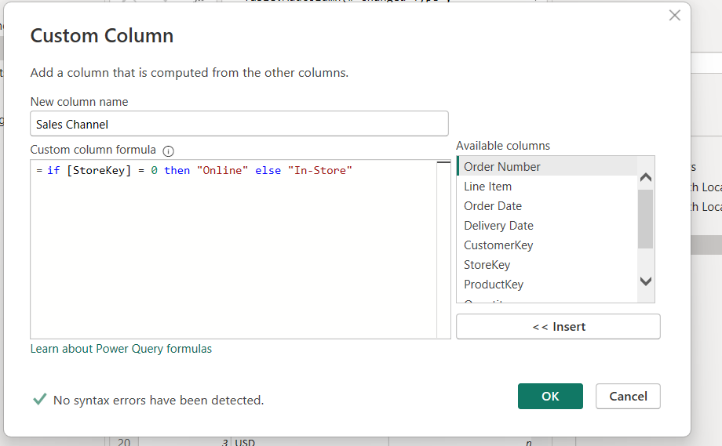

### 6.5 Stores

- `Open Date` → Date (locale en-US)
- `Square Meters` → **Whole Number** explicitly. The blank on the Online row had made Power Query treat the column as text, which caused "Error fetching data" in the Revenue per m² measure. The Online row stays **null**, not 0, so it never drags down averages.

### 6.6 Final types (summary)

| Type | Columns |
|---|---|
| Whole Number | Order Number, Line Item, CustomerKey, StoreKey, ProductKey, Quantity, Delivery Days, Square Meters, SubcategoryKey, CategoryKey |
| Decimal Number | Unit Cost USD, Unit Price USD, Exchange |
| Date (en-US locale) | Order Date, Delivery Date, Birthday, Open Date, Date (Exchange_Rates) |
| Text | Names, Gender, City, State, Country, Continent, Zip Code, Brand, Category, Currency Code, Sales Channel |

---

## 7. Step 3 – Data model (star schema)

**Sales** is the fact table, holding the events and numbers. Customers, Products, Stores and a custom Date table are the dimensions that describe and filter it.

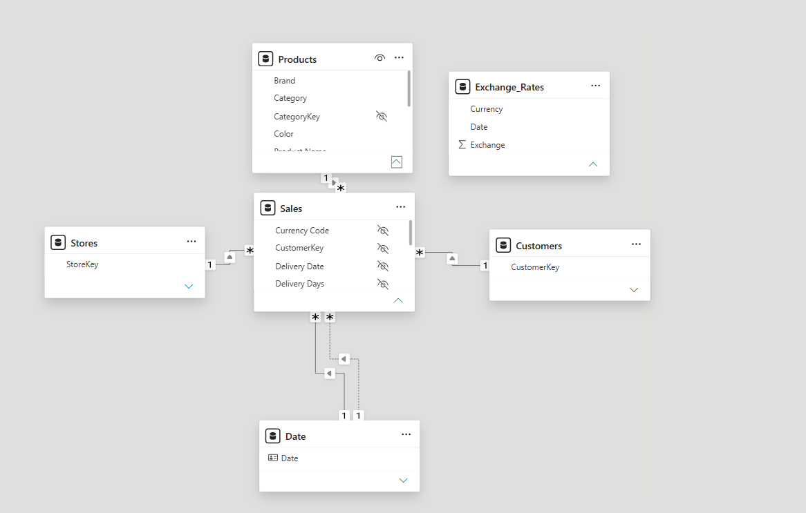
*The final model: dimensions around the Sales fact table, single-direction one-to-many relationships, and two relationships to Date (one active, one inactive/dotted). Key columns in Sales are hidden so reports filter through the dimensions.*

### 7.1 Custom Date table

**Auto date/time** was turned off (File → Options → Current File → Data Load), and a proper calendar was built in DAX, covering 1 January of the first order year to 31 December of the last delivery year:

```dax
Date =
VAR MinDate = DATE ( YEAR ( MIN ( Sales[Order Date] ) ), 1, 1 )
VAR MaxDate = DATE ( YEAR ( MAX ( Sales[Delivery Date] ) ), 12, 31 )
RETURN
    ADDCOLUMNS (
        CALENDAR ( MinDate, MaxDate ),
        "Year", YEAR ( [Date] ),
        "Quarter", "Q" & QUARTER ( [Date] ),
        "Month Number", MONTH ( [Date] ),
        "Month", FORMAT ( [Date], "mmm" ),
        "Year Month", FORMAT ( [Date], "mmm yyyy" ),
        "Year Month Sort", YEAR ( [Date] ) * 100 + MONTH ( [Date] ),
        "Weekday", FORMAT ( [Date], "ddd" ),
        "Weekday Number", WEEKDAY ( [Date], 2 ),
        "Is Weekend", IF ( WEEKDAY ( [Date], 2 ) > 5, "Weekend", "Weekday" )
    )
```

- Marked as a **date table** (Table tools → Mark as date table), which the time-intelligence functions require.
- **Sort by column** set so text sorts in calendar order: Month → Month Number, Year Month → Year Month Sort, Weekday → Weekday Number.
- Helper columns (Month Number, Year Month Sort, Weekday Number) hidden from report view.

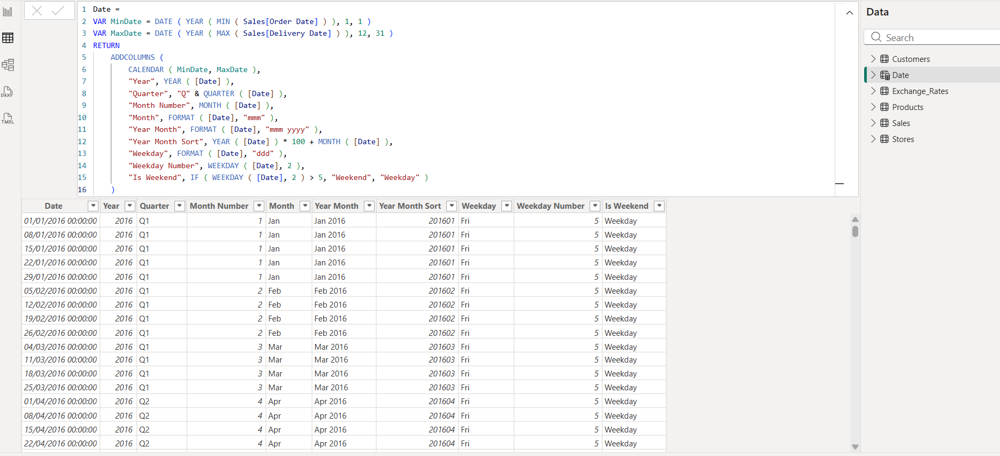

### 7.2 Relationships

| From (one) | To (many) | Status | Purpose |
|---|---|---|---|
| Customers[CustomerKey] | Sales[CustomerKey] | Active | Customer demographics and location |
| Products[ProductKey] | Sales[ProductKey] | Active | Prices, costs, brand, category |
| Stores[StoreKey] | Sales[StoreKey] | Active | Store country and size |
| Date[Date] | Sales[Order Date] | **Active** | All time-based analysis |
| Date[Date] | Sales[Delivery Date] | **Inactive** | Switched on inside measures with `USERELATIONSHIP` |

All relationships are **one-to-many with single-direction filtering** (dimension → fact). **Exchange_Rates** is deliberately left unconnected: its rows are identified by Date *and* Currency together, and all prices are already in USD.

---

## 8. Step 4 – Calculated columns (DAX)

### Customer age (at the last order date, not today)

```dax
Age =
VAR RefDate = MAX ( Sales[Order Date] )
RETURN
    INT ( YEARFRAC ( Customers[Birthday], RefDate ) )
```

The sales data ends in 2021. Using `TODAY()` would make every customer about five years older than when they actually shopped, so age is measured at the **last order date** in the data. `YEARFRAC` accounts for whether the birthday had happened that year; `INT` removes the decimal.

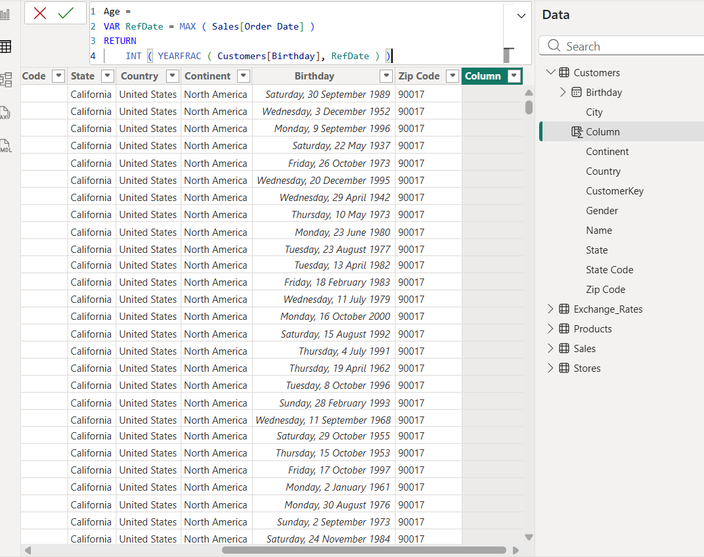

### Age group (for charts)

```dax
Age Group =
SWITCH (
    TRUE (),
    Customers[Age] < 25, "18–24",
    Customers[Age] < 35, "25–34",
    Customers[Age] < 45, "35–44",
    Customers[Age] < 55, "45–54",
    Customers[Age] < 65, "55–64",
    "65+"
)
```

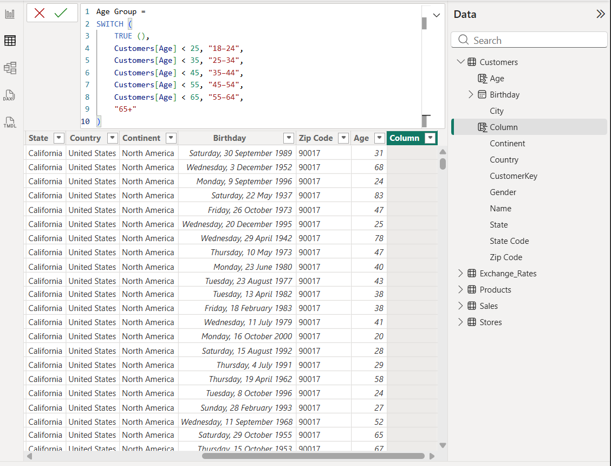

### Age group sort order

Text sorts alphabetically, so a numeric helper column was used to **sort Age Group by column**, then hidden:

```dax
Age Group Order =
SWITCH (
    TRUE (),
    Customers[Age] < 25, 1,
    Customers[Age] < 35, 2,
    Customers[Age] < 45, 3,
    Customers[Age] < 55, 4,
    Customers[Age] < 65, 5,
    6
)
```

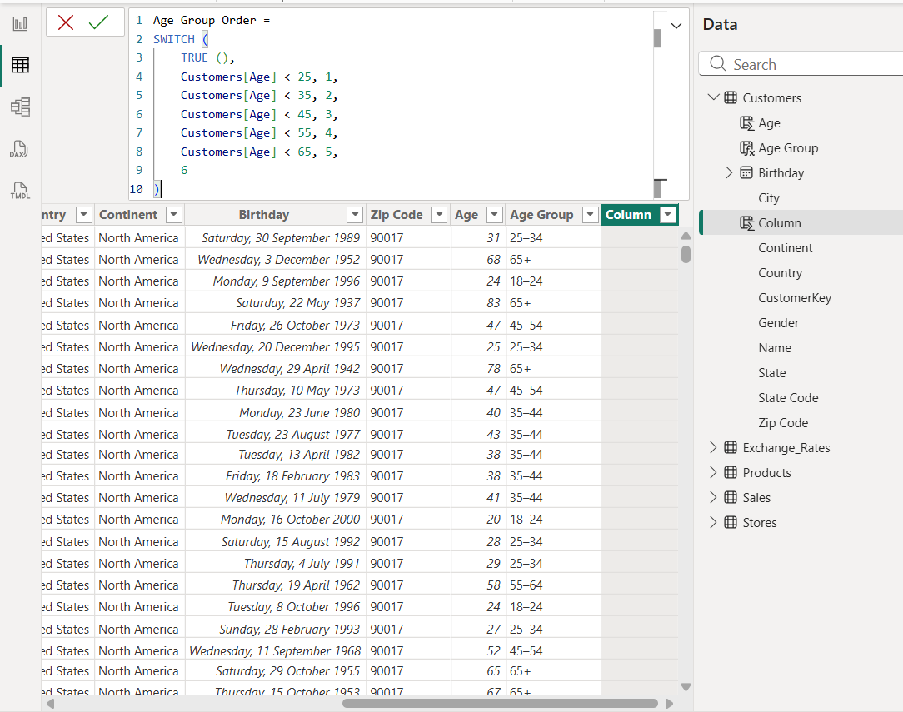

### Order frequency (how many orders each customer placed)

```dax
Order Frequency =
VAR n = CALCULATE ( DISTINCTCOUNT ( Sales[Order Number] ) )
RETURN
    SWITCH (
        TRUE (),
        n = 0, "No orders",
        n = 1, "1 order",
        n = 2, "2 orders",
        n = 3, "3 orders",
        "4+ orders"
    )
```

`CALCULATE` triggers **context transition**: for each customer row, it counts only that customer's orders.

### Month Start (continuous date axis)

```dax
Month Start = DATE ( 'Date'[Year], 'Date'[Month Number], 1 )
```

Trend lines in Power BI need a real date axis. `Year Month` is text ("Jan 2019"), so this column gives every month a real date, which allowed a **continuous axis and a trend line** on the delivery-time chart.

---

## 9. Step 5 – Measures (DAX)

All measures live in a dedicated `_Measures` table to keep the model tidy.

### 9.1 Core KPIs

```dax
Total Revenue = SUMX ( Sales, Sales[Quantity] * RELATED ( Products[Unit Price USD] ) )

Total Cost = SUMX ( Sales, Sales[Quantity] * RELATED ( Products[Unit Cost USD] ) )

Total Profit = [Total Revenue] - [Total Cost]

Profit Margin % = DIVIDE ( [Total Profit], [Total Revenue] )

Total Orders = DISTINCTCOUNT ( Sales[Order Number] )

Total Quantity = SUM ( Sales[Quantity] )

Avg Order Value = DIVIDE ( [Total Revenue], [Total Orders] )
```

- **Why `SUMX` + `RELATED`?** The Sales table has no price column. `SUMX` iterates over every sales row, `RELATED` fetches that product's price through the Products relationship, and the results are summed.
- **Why `DIVIDE`?** It returns blank instead of an error when the denominator is zero.
- **Why `DISTINCTCOUNT` for orders?** One order can have several line items (rows).

### 9.2 Time intelligence

```dax
Revenue PY =
VAR LastSaleDate = CALCULATE ( MAX ( Sales[Order Date] ), ALL ( Sales ) )
RETURN
    CALCULATE (
        [Total Revenue],
        SAMEPERIODLASTYEAR (
            FILTER ( VALUES ( 'Date'[Date] ), 'Date'[Date] <= LastSaleDate )
        )
    )

Revenue YoY % =
IF (
    HASONEVALUE ( 'Date'[Year] ),
    DIVIDE ( [Total Revenue] - [Revenue PY], [Revenue PY] )
)

Revenue YTD = TOTALYTD ( [Total Revenue], 'Date'[Date] )

Profit PY = CALCULATE ( [Total Profit], SAMEPERIODLASTYEAR ( 'Date'[Date] ) )

YoY Color = IF ( [Revenue YoY %] >= 0, "#27AE60", "#C0392B" )
```

- **Partial final year:** 2021 contains only about two months of data. A plain `SAMEPERIODLASTYEAR` compared those two months against the **whole** of 2020 and showed a misleading −88.8%. `Revenue PY` limits the comparison to dates up to the last sale, so 2021 is compared **like-for-like** with the same weeks of 2020.
- **YoY only for a single year:** with all years selected, "all years vs all years shifted back one" is meaningless, so `HASONEVALUE` returns blank until the viewer selects one year.
- **YoY Color** drives conditional formatting on the YoY card: green for growth, red for decline.

### 9.3 Customers

```dax
Total Customers = DISTINCTCOUNT ( Sales[CustomerKey] )

Revenue per Customer = DIVIDE ( [Total Revenue], [Total Customers] )

Orders per Customer = DIVIDE ( [Total Orders], [Total Customers] )

Repeat Customer % =
DIVIDE (
    COUNTROWS ( FILTER ( VALUES ( Sales[CustomerKey] ), [Total Orders] > 1 ) ) + 0,
    [Total Customers]
)

Avg Customer Age =
AVERAGEX ( FILTER ( Customers, [Total Orders] > 0 ), Customers[Age] )
```

- `Total Customers` counts customers **who purchased** (11,887), not every registered customer (15,266).
- The `+ 0` in `Repeat Customer %` shows 0% instead of blank when no selected customer repeated.
- `Avg Customer Age` averages only customers who bought something in the current filter, so it responds to slicers.

### 9.4 Products

```dax
Products Sold = DISTINCTCOUNT ( Sales[ProductKey] )

Profit per Unit = DIVIDE ( [Total Profit], [Total Quantity] )
```

### 9.5 Channels, stores and delivery

```dax
Online Revenue = CALCULATE ( [Total Revenue], Sales[Sales Channel] = "Online" )

In-Store Revenue = CALCULATE ( [Total Revenue], Sales[Sales Channel] = "In-Store" )

Online Revenue % =
DIVIDE (
    CALCULATE ( [Total Revenue], Sales[Sales Channel] = "Online" ),
    [Total Revenue]
)

Total Stores = CALCULATE ( DISTINCTCOUNT ( Sales[StoreKey] ), Sales[StoreKey] <> 0 )

Revenue per m2 =
DIVIDE (
    CALCULATE ( [Total Revenue], Sales[StoreKey] <> 0 ),
    SUM ( Stores[Square Meters] )
)

Avg Delivery Days = AVERAGE ( Sales[Delivery Days] )

Orders Delivered =
CALCULATE (
    [Total Orders],
    USERELATIONSHIP ( 'Date'[Date], Sales[Delivery Date] )
)
```

- `Revenue per m2` divides **in-store revenue only** by floor space. An earlier version divided all revenue, including online, by physical floor space, which overstated it.
- `Orders Delivered` activates the **inactive Delivery Date relationship** only inside this measure, so orders can be counted by the date they were *delivered* rather than *placed*.

### 9.6 Measures glossary

| Measure | Meaning, using this data |
|---|---|
| **Revenue PY** | Revenue for the same period one year earlier. The 2019 row shows $12.79M, which is 2018's revenue. |
| **Revenue YoY %** | (This year − last year) ÷ last year. 2019: ($18.26M − $12.79M) ÷ $12.79M = **+42.8%**. 2020: **−49.1%**. |
| **Revenue YTD** | Running total from 1 January to each point in the year, resetting every January. Dec 2019 YTD = $18.26M. |
| **Revenue per m²** | In-store revenue ÷ store floor area (online excluded). Overall **$479 per m²**. |
| **Repeat Customer %** | Share of purchasing customers with more than one order: **61.2%**. |
| **Avg Delivery Days** | Average days from order to delivery, online orders only. |

---

## 10. Step 6 – Dashboard design

Four report pages, one for each area of the business questions. Every page shares the same header (title + Country, Sales Channel and Year slicers), KPI card row and grid layout. Slicers are **synced across pages**, and a **page navigator** links the pages.

| Page | Answers | Main visuals |
|---|---|---|
| **1. Overview** | Q1 | KPI cards; monthly revenue vs previous year (line); revenue, profit and margin by year (column + line combo); online vs in-store (donut); revenue by category (bar) |
| **2. Product Performance** | Q2 | Category → subcategory matrix with data bars and margin colour scale; top 10 products by profit; revenue by brand; revenue-vs-margin scatter with average-line quadrants |
| **3. Customer Insights** | Q4 | Country matrix (customers, revenue, revenue per customer, repeat %); revenue by age group and gender; order frequency; revenue map |
| **4. Stores & Online Delivery** | Q3, Q5 | Store matrix (country → state) with revenue per m²; revenue by channel per year with online-share line; delivery days by country; delivery-time trend with trend line |

**Design decisions**
- **Titles state findings, not labels.** For example, "Revenue peaked in 2019 and roughly halved in 2020" instead of "Revenue by Year".
- **Honest axes.** The margin line uses a moderate axis range with data labels, so a 0.7-point change is neither hidden (0–100%) nor exaggerated (58.5–59%).
- **Linear lines, not smoothed curves**, so no highs or lows are invented between data points.
- **Edited interactions.** Clicking the order-frequency chart no longer filters the *Repeat Customer %* and *Orders per Customer* cards, because filtering by order count would make those metrics trivially 0% or 100%.
- **Custom dark theme** (JSON theme file + designed canvas backgrounds) for a consistent, modern look.

| | |
|---|---|
|  | 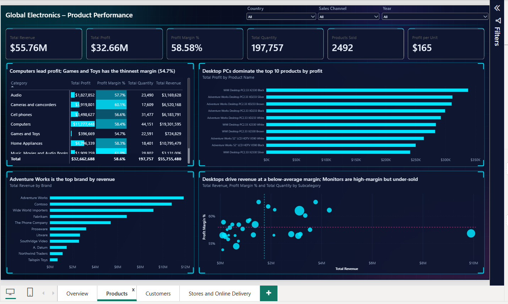 |
| 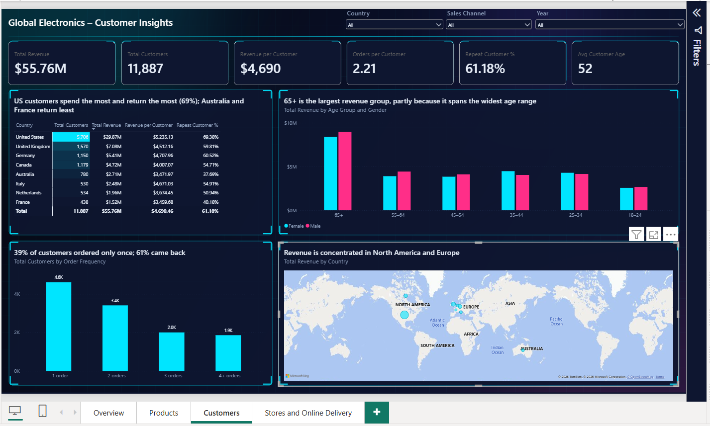 | 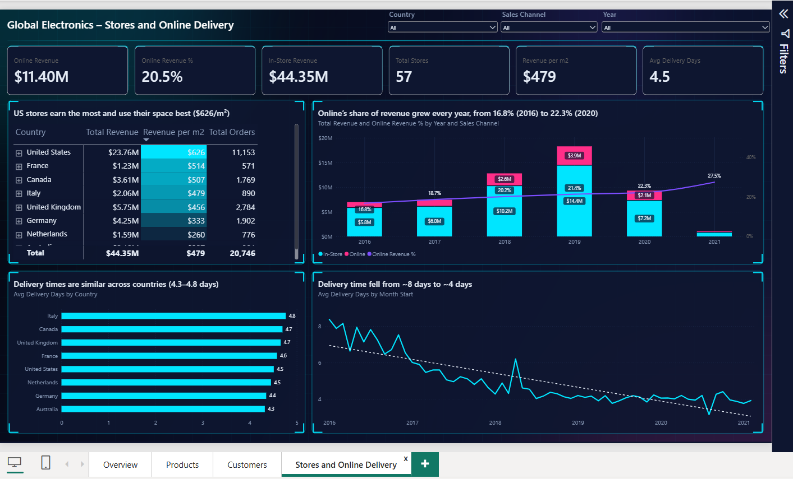 |

---

## 11. Answers to the business questions

### Q1. How have revenue and profit changed over time, and is the business growing?

| Year | Revenue | Profit | Margin | Orders | YoY revenue | Avg order value |
|---|---|---|---|---|---|---|
| 2016 | $6.95M | $4.11M | 59.1% | 2,865 | – | $2,425 |
| 2017 | $7.42M | $4.34M | 58.4% | 3,280 | +6.8% | $2,263 |
| 2018 | $12.79M | $7.46M | 58.4% | 5,965 | +72.3% | $2,144 |
| 2019 | $18.26M | $10.70M | 58.6% | 9,083 | +42.8% | $2,011 |
| 2020 | $9.29M | $5.45M | 58.6% | 4,635 | −49.1% | $2,005 |
| 2021* | $1.04M | $0.61M | 58.6% | 498 | partial | $2,087 |

*\*2021 covers January–February only.*

**Answer:** The business grew strongly to 2019, with revenue up **2.6×** from 2016, then **roughly halved in 2020**. The decline came from **volume, not price**: orders fell 49% (9,083 → 4,635), while average order value (~$2,000) and margin (~58.6%) barely moved. The 2020 timing coincides with the COVID-19 pandemic, but the data alone can't prove the cause. With 2021 incomplete, the data ends without clear evidence of a recovery.

**Margin:** 59.1% in 2016, dipping to ~58.4% in 2017–18 and holding ~58.6% after. Because each product has a single fixed price and cost in this dataset, margin can only change through **product mix**: after 2016, customers bought proportionally more lower-margin items.

### Q2. Which products, brands and categories make the most profit, not just the most sales?

| Category | Revenue | Profit | Margin | Units |
|---|---|---|---|---|
| Computers | $19.30M | $11.28M | 58.4% | 44,151 |
| Home Appliances | $10.80M | $6.30M | 58.3% | 18,401 |
| Cameras and camcorders | $6.52M | $3.92M | 60.1% | 17,609 |
| TV and Video | $5.93M | $3.54M | 59.7% | 11,236 |
| Cell phones | $6.18M | $3.50M | 56.6% | 31,477 |
| Music, Movies and Audio Books | $3.13M | $1.91M | **61.0%** | 28,802 |
| Audio | $3.17M | $1.83M | 57.7% | 23,490 |
| Games and Toys | $0.72M | $0.40M | **54.7%** | 22,591 |

**Answer:**
- **Computers** lead on both revenue and profit, at about a third of all profit.
- **Revenue rank ≠ profit rank:** Cell phones out-sell TV and Video in revenue, but **TV and Video earns more profit** thanks to a higher margin (59.7% vs 56.6%).
- **Highest margins:** Music, Movies and Audio Books (61.0%) and Cameras (60.1%). **Thinnest:** Games and Toys (54.7%).
- **Top 10 products by profit** are almost all **desktop PCs** (WWI and Adventure Works models), plus a 52" LCD HDTV.
- **Top brands by revenue:** Adventure Works, then Contoso and Wide World Importers.
- The **scatter chart** (revenue vs margin by subcategory, split by average lines) shows that **Desktops** is by far the biggest subcategory (~$10M revenue) but at a **below-average margin (~57%)**. **Monitors** and **Projectors & Screens** earn high margins (~62%), and Monitors is **under-sold** relative to its margin.

### Q3. Which countries and stores perform best, and how do online sales compare with in-store?

| Store country | In-store revenue | Revenue per m² | Orders |
|---|---|---|---|
| United States | $23.76M | **$626** | 11,153 |
| United Kingdom | $5.75M | $456 | 2,784 |
| Germany | $4.25M | $333 | 1,902 |
| Canada | $3.61M | $507 | 1,769 |
| Australia | $2.10M | **$227** | 901 |
| Italy | $2.06M | $479 | 890 |
| Netherlands | $1.59M | $260 | 776 |
| France | $1.23M | $514 | 571 |
| **Total (57 stores)** | **$44.35M** | **$479** | **20,746** |

**Answer:**
- **US stores** earn the most revenue **and** use their floor space best ($626 per m²). **Australia** ($227) and the **Netherlands** ($260) generate the least revenue per m².
- **France** is small in total but efficient ($514 per m²), so size and efficiency are different stories.
- **Online** brings in **$11.40M (20.5%)** from 5,580 orders, against **$44.35M** in-store.
- **Online's share grew every year:** 16.8% (2016) → 18.7% → 20.2% → 21.4% → **22.3% (2020)**, with 27.5% in the partial 2021 data.

### Q4. Who are our customers, and who buys the most?

| Customer country | Customers | Revenue | Revenue per customer | Repeat % |
|---|---|---|---|---|
| United States | 5,706 | $29.87M | **$5,235** | **69.4%** |
| United Kingdom | 1,570 | $7.08M | $4,512 | 59.8% |
| Canada | 1,179 | $4.72M | $4,007 | 54.7% |
| Germany | 1,150 | $5.41M | $4,708 | 60.5% |
| Australia | 780 | $2.71M | $3,472 | **37.7%** |
| Netherlands | 534 | $1.96M | $3,674 | 50.9% |
| Italy | 530 | $2.48M | $4,671 | 54.9% |
| France | 438 | $1.52M | $3,460 | **40.2%** |
| **Total** | **11,887** | **$55.76M** | **$4,690** | **61.2%** |

**Answer:**
- **Location:** revenue is concentrated in **North America and Europe**. The **US** has the most customers, the highest spend per customer (~$5,235) and the strongest loyalty (69.4% repeat). **Australia (37.7%)** and **France (40.2%)** have the lowest repeat rates.
- **Loyalty:** **61.2%** of customers ordered more than once (2.21 orders per customer on average). About **4,600 customers (38.8%) ordered only once**.
- **Registered but inactive:** 15,266 customers are registered but only 11,887 placed an order, so about **3,400 never purchased**.
- **Age:** average age ~52. The **65+** group brings in the most revenue, but it spans the widest age range (65 to 85+) and so contains more customers. Spending is otherwise fairly even across the 25–64 groups, and lowest for 18–24.
- **Gender:** revenue is split almost evenly between female and male customers in every age group.

### Q5. How long do online deliveries take, and is that improving?

**Answer:**
- Online orders take **about 4.5 days** on average to deliver.
- **It has improved a lot:** monthly average delivery time **roughly halved**, from **~8 days in 2016 to ~4 days by 2020–21**, a clear downward trend line.
- Delivery is **consistent across countries**, between **4.3 and 4.8 days**, so there is no country with a delivery problem.
- Faster delivery and a growing online share happened over the same years. The data shows they moved together but doesn't prove that one caused the other.

---

## 12. Recommendations

1. **Recover order volume rather than cutting prices.** The 2020 decline was driven by fewer orders while margin and order value held, so marketing and demand generation matter more than discounting.
2. **Keep investing in online.** Its share rose every year and delivery times halved; it's the most consistently growing part of the business.
3. **Promote high-margin, under-sold lines.** Bundle Monitors, Projectors & Screens and Cameras with the best-selling Desktops to lift profit per order.
4. **Review Games and Toys pricing and costs.** At 54.7%, it has the thinnest margin of any category.
5. **Run retention programmes in Australia and France,** where only ~38–40% of customers come back (vs 69% in the US). Also run an **activation campaign** for the ~3,400 registered customers who have never ordered.
6. **Review store formats in Australia and the Netherlands,** which earn the least revenue per m²: consider smaller footprints or relocation.

---

## 13. Assumptions and limitations

- **Static prices and costs:** each product has one price and one cost for the whole period, so margin changes reflect product mix only, not pricing decisions.
- **Partial 2021:** data ends in February 2021. 2021 is labelled as partial and compared like-for-like.
- **Static floor area:** store size doesn't account for opening dates, so stores that opened mid-period are slightly understated on revenue per m².
- **Cause of the 2020 drop:** the COVID-19 explanation is a reasonable hypothesis based on timing, not something the data proves.
- **Exchange rates unused:** all prices are already in USD, so local-currency reporting was out of scope.
- **Wider 65+ age band:** comparisons between age groups reflect both spending and group size.
- **Fictional data:** the dataset is synthetic and provided by Maven Analytics for practice.

---

## 14. Repository structure

```
global-electronics-powerbi/
├── data/
│   └── raw/                      # Original CSVs (unedited)
├── excel/                        # Data profiling workbook / notes
├── powerbi/
│   ├── Global_Electronics.pbix   # Power BI report
│   └── Global_Electronics.pdf    # PDF export of all 4 pages
├── design/                       # Theme JSON + background images
├── images/
│   ├── process/                  # Power Query, DAX and model screenshots
│   └── dashboard/                # Final dashboard pages
└── README.md
```

**To explore the report:** download `powerbi/Global_Electronics.pbix` and open it in [Power BI Desktop](https://powerbi.microsoft.com/desktop/) (free). No Power BI? Open `powerbi/Global_Electronics.pdf` to view every page.

---

### Author

**Joshua Akhigbe Adomokhai**, Data Analyst
[LinkedIn](https://www.linkedin.com/in/joshua-akhigbe-733400284/) · [GitHub](https://github.com/Zhakingg)
